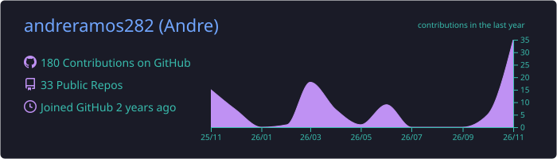
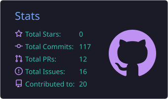
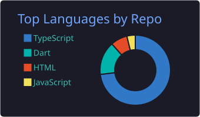
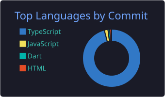
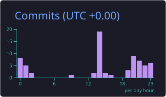

<h1 align="center">Olá, eu sou o André Ramos 👋</h1>

  Estudante de <b>Desenvolvimento de Software Multiplataforma</b> na <b>FATEC Jacareí</b> · Jacareí-SP

  
  

---

## 🚀 Sobre mim

- 🎓 Cursando **DSM na FATEC Jacareí** (5º semestre)
- 🧪 Venho da área técnica: **Técnico em Química** (ETEC) e alguns anos como **operador de ETA**, cuidando sozinho da operação de uma estação de tratamento de água durante o turno
- 💻 Hoje foco em **desenvolvimento web, mobile e dados/ML**
- 🛰️ Já participei de projetos em parceria com o **INPE**
- 🌎 Inglês e espanhol intermediários

## 🔭 No momento

- 📊 **ABP – Predição de desempenho no ENEM**: modelo de Machine Learning + plataforma web para escolas e secretarias
- 📱 Desenvolvendo apps em **Flutter**
- ☁️ Estudando **Computação em Nuvem (AWS)** e **Segurança Web (OWASP)**
- 🤖 Aprofundando em **Aprendizado de Máquina** (SVM, Árvores de Decisão, scikit-learn)

## 🛠️ Tecnologias

  
   
  
   
  

## 📌 Projetos em destaque

| Projeto | Descrição | Stack |
|---|---|---|
| 🛰️ [**Datlas**](https://github.com/My0pes/Datlas-3DSM) | Plataforma com o **INPE** para comparar dados de satélite (Sentinel, Landsat): mapa interativo, consulta STAC, séries temporais de NDVI/EVI, temperatura e umidade, exportação de dados | Web · Mapas · STAC |
| 🔥 [**Turi**](https://github.com/My0pes/Turi-Myopes-2DSM) | Site com o **INPE** sobre focos de calor, risco de fogo e área queimada por estado/bioma, com mapas interativos e gráficos (equipe de 6) | React · TypeScript · Node.js · PostgreSQL · Figma |
| 📊 [**ABP ENEM**](https://github.com/andreramos282/abp-enem) | Predição de desempenho de estudantes no ENEM com microdados do INEP + plataforma web | Python · ML · Web |
| 🎓 [**App Scholar**](https://github.com/andreramos282/app-scholar) | Sistema de gestão acadêmica completo | Web |
| 🎮 [**HabitQuest**](https://github.com/andreramos282/habitquest) | App de hábitos desenvolvido em Flutter | Flutter · Dart |
| 🥗 [**Nutri App**](https://github.com/andreramos282/nutri-app) | App de nutrição: contagem de calorias, registro de alimentos e controle da dieta | Mobile |

## 📊 Estatísticas

  

  
  

  
  

---

💬 Fale comigo sobre web, mobile, dados ou projetos acadêmicos!

